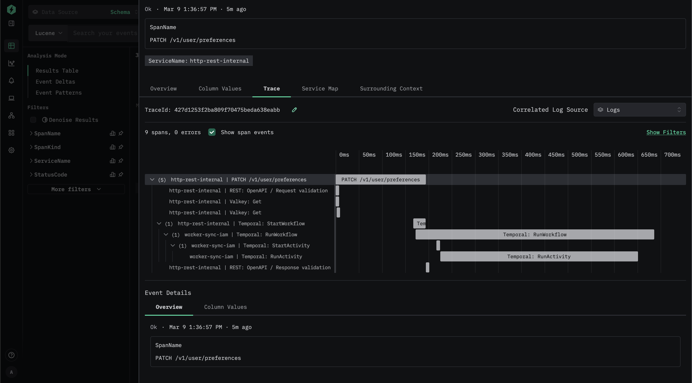

# helix.go

[](https://pkg.go.dev/github.com/mountayaapp/helix.go)
[](https://github.com/mountayaapp/helix.go/tags)
[](https://opensource.org/licenses/MIT)

helix is a Go library for building observable microservices. Every integration
— REST, GraphQL, MCP, Temporal, PostgreSQL, and more — ships with distributed tracing,
structured logging, error recording, and health checks via
[OpenTelemetry](https://opentelemetry.io/). No manual instrumentation, no
boilerplate.

## Why helix

- **Zero-config observability.** All integrations emit distributed traces, metrics,
  and structured logs correlated with their traces, and record errors via
  OpenTelemetry out of the box.

- **Solid foundations.** Every integration is thread-safe, connection-pooled,
  and heavily tested. Built for services that handle real traffic at scale.

- **End-to-end context propagation.** Attach an `event.Event` once and its
  identifiers travel across service boundaries — REST handlers, Temporal workflows,
  database calls — alongside the distributed trace. Personal data never leaves the
  process.

- **Consistent error handling.** The `errorstack` package emits a single
  GraphQL-spec error envelope (`{errors:[…], extensions:{…}}`) shared by REST and
  GraphQL APIs. Same shape, same machine-readable codes, across every integration.

- **Type-safe by default.** Go generics enforce type safety at every layer — from
  HTTP response builders to event propagation — catching bugs at compile time.

- **Spec-driven APIs.** The REST integration validates requests and responses against
  your [OpenAPI](https://www.openapis.org/) spec at runtime. The GraphQL integration
  uses [gqlgen](https://gqlgen.com/)'s schema-first approach with generated types
  and resolvers.

- **Managed lifecycle.** `svc.Run(ctx)` starts every server, blocks until the
  context is cancelled, and always tears down — servers drain, dependencies close
  concurrently, telemetry flushes — including when startup failed. Signals belong
  to your `main`; cancel the context you hand it.

- **Testable instrumentation.** `service/servicetest` gives a Service whose
  traces, logs and metrics are recorded in memory, so a test can assert on what
  your handlers actually emitted.

## Requirements

- Go 1.27 or later

## Quick start

```sh
$ go get github.com/mountayaapp/helix.go
```

```go
package main

import (
  "context"
  "log/slog"
  "net/http"
  "os"
  "os/signal"
  "syscall"

  "github.com/mountayaapp/helix.go/service"
  "github.com/mountayaapp/helix.go/integration/postgres"
  "github.com/mountayaapp/helix.go/integration/rest"
)

func main() {
  if err := run(); err != nil {
    slog.Error("fatal", "err", err)
    os.Exit(1)
  }
}

func run() error {
  ctx, stop := signal.NotifyContext(context.Background(), os.Interrupt, syscall.SIGTERM)
  defer stop()

  // Create the Service. It auto-detects the cloud provider and sets up
  // OpenTelemetry for logging and tracing.
  svc, err := service.New(ctx, service.Config{})
  if err != nil {
    return err
  }

  // Dependencies are built with a context, then attached under a name you
  // choose — so two pools of the same kind stay distinguishable.
  // Connect registers the pool with the Service, which owns its lifecycle from
  // there. What you get back can query, not close.
  db, err := postgres.Connect(ctx, svc, postgres.Config{
    Name:     "primary",
    Database: "myapp",
    User:     "postgres",
    Password: os.Getenv("POSTGRES_PASSWORD"),
  })
  if err != nil {
    return err
  }

  // Create a REST API on port 8080. Its readiness probe reports on every
  // dependency attached to the Service.
  api, err := rest.New(ctx, svc, rest.Config{Address: ":8080"})
  if err != nil {
    return err
  }

  api.GET("/hello", func(rw http.ResponseWriter, req *http.Request) {
    // db is available here; its lifecycle belongs to svc.
    _ = db

    rest.NewResponseSuccess[rest.NoMetadata, rest.NoData](req).
      SetStatus(http.StatusOK).
      Write(rw)
  })

  // Run blocks until SIGINT/SIGTERM, then drains the servers, closes the
  // dependencies, and flushes telemetry — including when startup failed.
  return svc.Run(ctx)
}
```

The REST API already emits OpenTelemetry traces and metrics for every request,
records errors, and exposes liveness (`GET /health`) and readiness (`GET /ready`)
probes — no additional setup required.

## Viewing traces and logs locally

helix exports traces, metrics and logs via OTLP. To see them locally, you can start
an all-in-one observability stack with [ClickStack](https://clickhouse.com/clickstack):

1. Start ClickStack:

   ```sh
   $ docker run --name clickstack \
     -p 8123:8123 -p 8080:8080 -p 4317:4317 -p 4318:4318 \
     clickhouse/clickstack-all-in-one:latest clickstack
   ```

2. Open `http://localhost:8080`, create your account, then copy your ingestion
   API key from **Team Settings → API Keys**.

3. Run your service with the right environment variables:

   ```sh
   $ OTEL_EXPORTER_OTLP_ENDPOINT=http://localhost:4318 \
     OTEL_EXPORTER_OTLP_HEADERS="Authorization=<your-ingestion-key>" \
     OTEL_SERVICE_NAME=my-service \
     go run .
   ```

You'll see distributed traces for every request in the ClickStack UI.

### One vocabulary, owned

Every span helix emits is named `<Humanized>: <Operation>` and carries attribute
keys of the form `<identifier>.<path>` — `PostgreSQL: Exec` with `postgres.query`,
`Bucket: Write` with `bucket.key`, `REST: GET /things/:id` with `rest.route`. One
convention across all nine integrations, built in one place
(`integration.Instrument`) and enforced by a test
(`servicetest.AssertConvention`).

That is a deliberate trade. A backend's built-in HTTP and database views key off
the OpenTelemetry semantic conventions and will not recognise these attributes, so
dashboards query `rest.*` rather than `http.*`. What it buys is that the same
question has the same answer in every integration — which composing upstream
instrumentation cannot give you, since each package is pinned to whichever
semantic convention version it happened to adopt, and they are years apart.

One consequence is worth stating plainly: **helix suppresses `gocloud.dev/blob`'s
own spans and metrics.** The bucket integration is built on gocloud, which emits
from the global tracer and meter providers with no way to inject one and no way to
turn it off, so every bucket operation was recorded twice. It is the only
third-party instrumentation helix discards.

The screenshot below shows a trace where an HTTP API flows into a Temporal worker
with full event context preserved end-to-end. Developers only wrote business logic;
all observability was handled by helix.



## Core concepts

### Service

The `Service` is the central container. It owns the logger, tracer, and cloud
provider detection, and manages the full application lifecycle — including the
lifecycle of every integration attached to it. More than one may exist in a
process.

The zero `Config` is usable: resources are detected from the standard `OTEL_*`
environment, the global OpenTelemetry providers are installed, and shutdown gets a
30-second budget.

```go
svc, err := service.New(ctx, service.Config{
  ShutdownTimeout: 10 * time.Second,
})
```

Config fields:

- `ShutdownTimeout` — Maximum duration for graceful shutdown. Zero means 30 seconds.
  Up to five seconds of it (a quarter, when it is shorter than twenty) is kept for
  flushing telemetry last.
- `LogLevel` — Minimum level logged, to stderr and to the OpenTelemetry export
  alike (`log.LevelDebug` … `log.LevelError`). Zero defers to `OTEL_LOG_LEVEL`, then
  info.
- `SkipGlobals` — Leave the process-wide OpenTelemetry providers and propagator
  untouched, along with the default logger and tracer that `telemetry/log` and
  `telemetry/trace` fall back to. Set it when a second `Service` runs in the same
  process, or when the application installs its own globals.
- `TracerProvider` / `LoggerProvider` / `MeterProvider` — Supply telemetry
  providers instead of the SDK ones built from the environment. These are API
  types, so the `Service` does not own their lifecycle. `service/servicetest` uses
  them to record all three signals in memory.
- `Propagator` — The `TextMapPropagator` used to carry trace context across
  process boundaries. Zero means the W3C pair (`TraceContext` + `Baggage`). The
  integrations carry this one rather than reading the global, so `SkipGlobals`
  does not silently stop propagation.

Signal handling belongs to the application: cancel the context you pass to `Run`.
`Run` also returns when any server exits on its own.

```go
ctx, stop := signal.NotifyContext(context.Background(), os.Interrupt, syscall.SIGTERM)
defer stop()

return svc.Run(ctx)
```

Applications that embed a `Service` in a lifecycle of their own call `Start` and
`Stop` instead of `Run`, and wait on `svc.Done()` — closed when a server exits or
`Stop` is called — with `svc.Err()` reporting why. A stopped `Service` cannot be
started again.

Tracing, metrics, logging, and exporter configuration are controlled through
OpenTelemetry environment variables (see [Environment variables](#environment-variables)).

### Integrations

helix models integrations as two types that map to the service lifecycle:

| | Server | Dependency |
|---|---|---|
| **Role** | Defines how the service accepts work | Connects to an external system |
| **Interface** | `integration.Server` | `integration.Dependency` |
| **Cardinality** | Many per Service | Many per Service |
| **Constructor** | `New(ctx, svc, ...)` | `Connect(ctx, svc, ...)` |
| **Registration** | Automatic, inside the constructor | Automatic, inside the constructor |
| **Startup** | Blocking — listens for incoming work | Eager — connects and pings in constructor |
| **Shutdown** | Stopped first (drains in-flight work) | Closed concurrently after server stops |

A constructor takes a context and the Service, dials, registers itself, and hands
back a narrow interface — one that can *use* the connection but not close it. The
Service owns every lifecycle: you cannot start a server twice, close a pool the
Service still holds, or forget to shut something down, because the handle you hold
has no such methods. `Config.Name` is what distinguishes two pools of the same kind
in health output and error context.

#### Servers

Servers define how a service receives and processes work. More than one can be
registered: a REST API alongside a Temporal worker is an ordinary shape.

- **[REST API](./integration/rest/README.md)** — HTTP router with OpenAPI
  validation, typed responses, and path parameters.
- **[GraphQL API](./integration/graphql/README.md)** — GraphQL server with
  schema-first design, body, depth and complexity limits, optional GraphiQL
  playground and automatic persisted queries (backed by any cache, Valkey included).
- **[MCP server](./integration/mcp/README.md)** — Model Context Protocol server
  over Streamable HTTP, with swappable authentication including OAuth 2.0 Resource
  Server support.
- **[Temporal worker](./integration/temporal/README.md)** — Workflow and activity
  worker with typed handles, graceful activity draining, and tracing across
  workflow executions.

#### Dependencies

Dependencies connect to external systems. Multiple dependencies can be attached
to a single service.

- **[Temporal](./integration/temporal/README.md)** — Client for starting,
  signalling, querying, updating and scheduling workflows.
- **[PostgreSQL](./integration/postgres/README.md)** — Transactional database
  (also supports CockroachDB, Neon, AlloyDB, and other PostgreSQL-compatible
  databases).
- **[ClickHouse](./integration/clickhouse/README.md)** — Analytical database
  optimized for batch writes and columnar queries.
- **[Valkey](./integration/valkey/README.md)** — In-memory key/value store for
  caching.
- **[Bucket](./integration/bucket/README.md)** — Blob storage with drivers for S3
  (Amazon S3 and S3-compatible services), Azure Blob Storage, Google Cloud Storage.
- **[HTTP Client](./integration/httpclient/README.md)** — Client for external HTTP
  APIs with round-robin across endpoints, failover that never replays a
  non-idempotent request, same-host redirects only, and opt-in per-endpoint health
  checks.

> **Note:** Integrations in this repository are maintained exclusively by the helix
> team. We do not accept new integrations via pull requests, but you are free to
> build and publish your own in a separate module.

#### Shutdown order

When `svc.Stop()` is called — which `svc.Run()` always does, on every exit path:

1. All servers stop first, concurrently, draining in-flight work. A request that
   does not end on its own — a server-sent event stream — has its context
   cancelled once half the budget is gone, and is closed when the budget runs out.
2. All dependencies close concurrently once the servers are idle.
3. Telemetry flushes: traces, then metrics, then logs, then stderr is synced.

This guarantees no dependency connection is torn down while a server is still
processing requests, and that telemetry is flushed last, with time reserved for it.

Every wait is bounded by `ShutdownTimeout`, including the ones on integrations
helix does not control: an integration that will not drain is reported as such
rather than allowed to hold the process open, because teardown that cannot finish
loses the same telemetry as teardown that never ran. A telemetry collector that
cannot be reached is logged to stderr rather than reported as a shutdown failure,
so that it cannot turn a clean shutdown into a non-zero exit code.

### Health probes

Every HTTP server integration answers `GET /health` (liveness: the process is
serving) and `GET /ready` (readiness: every server and dependency attached to the
`Service` is healthy). Concurrent readiness probes share one check.

A failing readiness probe answers a generic `503` envelope:

```json
{"errors":[{"message":"Service is temporarily unavailable","extensions":{"code":"SERVICE_UNAVAILABLE"}}]}
```

The probes are served on the application's own listener, to callers helix knows
nothing about, and the reason a dependency is unhealthy — a driver error — names
hosts, users and databases. Which integration failed, and why, is written to the
log and recorded on the probe's span instead.

### Trust boundary

An HTTP server continues the trace its caller sent and reads the caller's baggage,
which is what makes a request crossing several helix services one trace. Of an
`Event`, only six fields ever travel in baggage — the event's ID and name, the
organization and tenant identifiers, and the application's name and version — in
both directions: helix never puts any other `Event` field in baggage, and never
reads any other back. Personal data (`UserID`, `IP`, `UserAgent`, device,
location, …) stays on the local span.

Baggage that is not the `Event`'s is passed on as it was received: whatever a
caller of a non-public server sent travels on with the outbound calls that server
makes. For calls to a third party, give the HTTP client `Propagator:
propagation.TraceContext{}` so that it sends the trace context and no baggage at
all.

A server reachable from the internet should not trust what its caller sends. Set
`PublicEndpoint: true` in its config: the server then starts a trace of its own
(linked to the caller's, so the two remain navigable) and ignores inbound baggage,
so that nothing a client puts in its headers is propagated onward as though a
trusted upstream service had set it. An `Event` rebuilt from inbound baggage is
client input either way: fine for correlating telemetry, never a basis for an
authorization decision.

## Examples

<details>
  <summary>Full application with multiple integrations</summary>

  ```go
  package main

  import (
    "context"
    "log/slog"
    "net/http"
    "os"
    "os/signal"
    "syscall"

    "github.com/mountayaapp/helix.go/integration/postgres"
    "github.com/mountayaapp/helix.go/integration/rest"
    "github.com/mountayaapp/helix.go/integration/valkey"
    "github.com/mountayaapp/helix.go/service"
    "github.com/mountayaapp/helix.go/telemetry/log"
  )

  func main() {
    if err := run(); err != nil {
      slog.Error("fatal", "err", err)
      os.Exit(1)
    }
  }

  func run() error {
    ctx, stop := signal.NotifyContext(context.Background(), os.Interrupt, syscall.SIGTERM)
    defer stop()

    svc, err := service.New(ctx, service.Config{})
    if err != nil {
      return err
    }

    // Connect each dependency under a name of your choosing. Connect pings it,
    // and registers it with the Service, which closes it on shutdown once the
    // servers have drained.
    db, err := postgres.Connect(ctx, svc, postgres.Config{
      Name:     "primary",
      Address:  "127.0.0.1:5432",
      Database: "myapp",
      User:     "postgres",
      Password: os.Getenv("POSTGRES_PASSWORD"),
    })
    if err != nil {
      return err
    }

    cache, err := valkey.Connect(ctx, svc, valkey.Config{
      Name:    "cache",
      Address: "127.0.0.1:6379",
    })
    if err != nil {
      return err
    }

    // Create the server. PublicEndpoint: it is reachable from the internet, so
    // it does not trust the trace context and baggage its callers send.
    router, err := rest.New(ctx, svc, rest.Config{
      Address:        ":8080",
      PublicEndpoint: true,
    })
    if err != nil {
      return err
    }

    router.GET("/users/:id", func(rw http.ResponseWriter, req *http.Request) {
      params, _ := rest.ParamsFromContext(req.Context())
      log.Info(req.Context(), "fetching user", log.String("id", params["id"]))

      // Use db and cache here...
      _ = db
      _ = cache

      rest.NewResponseSuccess[rest.NoMetadata, rest.NoData](req).
        SetStatus(http.StatusOK).
        Write(rw)
    })

    return svc.Run(ctx)
  }
  ```
</details>

<details>
  <summary>REST API with typed responses</summary>

  The REST integration uses Go generics for type-safe JSON responses. The
  `Metadata` and `Data` type parameters control the shape of the response body.

  ```go
  import (
    "net/http"

    "github.com/mountayaapp/helix.go/errorstack"
    "github.com/mountayaapp/helix.go/integration/rest"
  )

  type UserMetadata struct {
    RequestID string `json:"request_id"`
  }

  type User struct {
    ID   string `json:"id"`
    Name string `json:"name"`
  }

  router.GET("/users/:id", func(rw http.ResponseWriter, req *http.Request) {
    params, _ := rest.ParamsFromContext(req.Context())

    user, err := fetchUser(params["id"])
    if err != nil {

      // Error response — returns {"errors":[{"message":"Resource does not exist","extensions":{"code":"NOT_FOUND"}}]}
      rest.NewResponseError[rest.NoMetadata](req).
        SetStatus(http.StatusNotFound).
        Write(rw)
      return
    }

    // Success response — returns {"data":{...},"extensions":{"metadata":{...}}}
    rest.NewResponseSuccess[UserMetadata, User](req).
      SetStatus(http.StatusOK).
      SetMetadata(UserMetadata{RequestID: "abc-123"}).
      SetData(*user).
      Write(rw)
  })
  ```

  Use `rest.NoMetadata` and `rest.NoData` when you don't need those fields in the
  response.
</details>

<details>
  <summary>Event propagation across services</summary>

  An `event.Event` describes what a request is about. Attach it to the context
  once: the integrations stamp all of it on the entry span — locally — and carry
  its identifiers to the services and workflows the request reaches.

  Only six fields ever leave the process: the event's `ID` and `Name`, the
  `OrganizationID` and `TenantID`, and the application's name and version. They
  travel as W3C baggage over HTTP, and in a dedicated `event` header through
  Temporal, encoded with the client's `DataConverter`. Personal data — `UserID`,
  `IP`, `UserAgent`, device, location — stays on the local span.

  ```go
  import (
    "net/http"

    "github.com/mountayaapp/helix.go/event"
    "github.com/mountayaapp/helix.go/integration/rest"

    "go.temporal.io/sdk/client"
  )

  router.POST("/orders", func(rw http.ResponseWriter, req *http.Request) {

    // Attach the event to the context.
    ctx := event.NewContext(req.Context(), event.Event{
      ID:       "evt_123",
      Name:     "order.placed",
      TenantID: "tenant_42",
      UserID:   "usr_123", // On this service's spans only.
    })

    // The workflow — and every activity it schedules — receives the event's
    // identifiers through ctx.
    _, err := temporalClient.ExecuteWorkflow(ctx, ProcessOrder, client.StartWorkflowOptions{
      TaskQueue: "orders",
    }, input)
    if err != nil {
      rest.NewResponseError[rest.NoMetadata](req).
        SetStatus(http.StatusServiceUnavailable).
        Write(rw)
      return
    }

    rest.NewResponseSuccess[rest.NoMetadata, rest.NoData](req).
      SetStatus(http.StatusAccepted).
      Write(rw)
  })
  ```

  `temporal.ConfigClient.PropagateFullEvent` opts in to sending the whole `Event`
  through Temporal. Temporal history keeps the header for the namespace's
  retention period, so opt in only when the workflows need the personal data and
  the history may hold it.
</details>

<details>
  <summary>MCP server with a tool</summary>

  The MCP integration serves Model Context Protocol tools, resources, and prompts
  over Streamable HTTP. Attach your tools through the `Register` hook; typed input
  and output structs drive the tool's JSON schemas automatically.

  ```go
  import (
    "context"
    "log/slog"
    "os"
    "os/signal"
    "syscall"

    "github.com/mountayaapp/helix.go/service"
    "github.com/mountayaapp/helix.go/integration/mcp"
  )

  type GreetInput struct {
    Name string `json:"name" jsonschema:"the person to greet"`
  }

  type GreetOutput struct {
    Greeting string `json:"greeting" jsonschema:"the rendered greeting"`
  }

  func main() {
    if err := run(); err != nil {
      slog.Error("fatal", "err", err)
      os.Exit(1)
    }
  }

  func run() error {
    ctx, stop := signal.NotifyContext(context.Background(), os.Interrupt, syscall.SIGTERM)
    defer stop()

    svc, err := service.New(ctx, service.Config{})
    if err != nil {
      return err
    }

    err = mcp.New(ctx, svc, mcp.Config{
      ServerInfo: mcp.ServerInfo{Name: "greeter", Version: "v1.0.0"},
      Register: func(server *mcp.Server) {
        mcp.AddTool(server, &mcp.Tool{
          Name:        "greet",
          Description: "Greets a person by name.",
          Annotations: &mcp.ToolAnnotations{Title: "Greet", ReadOnlyHint: true},
        }, func(ctx context.Context, req *mcp.CallToolRequest, in GreetInput) (*mcp.CallToolResult, GreetOutput, error) {
          return nil, GreetOutput{Greeting: "Hi " + in.Name}, nil
        })
      },
    })
    if err != nil {
      return err
    }

    return svc.Run(ctx)
  }
  ```
</details>

<details>
  <summary>Structured logging with automatic context</summary>

  Logs are automatically enriched with the current trace and span IDs from
  the context. No need to manually pass correlation keys.

  ```go
  import (
    "net/http"

    "github.com/mountayaapp/helix.go/integration/rest"
    "github.com/mountayaapp/helix.go/telemetry/log"
  )

  router.POST("/orders", func(rw http.ResponseWriter, req *http.Request) {
    
    // This log entry is automatically tied to the current trace and span.
    log.Info(req.Context(), "processing order",
      log.String("user_id", "usr_123"),
      log.Int("item_count", 3),
    )

    rest.NewResponseSuccess[rest.NoMetadata, rest.NoData](req).
      SetStatus(http.StatusAccepted).
      Write(rw)
  })
  ```

  Outside a request — in `main`, or in work detached from one — `log` and `trace`
  fall back to the Service's logger and tracer, which `service.New` installs
  process-wide unless `SkipGlobals` is set.

  Available log levels: `log.Debug`, `log.Info`, `log.Warn`, `log.Error`.

  Available field types: `log.String`, `log.Int`, `log.Int64`, `log.Float64`,
  `log.Bool`, `log.Err`, `log.Any`, `log.Duration`.

  An error handed to the logger as an error, with `log.Err` or with `log.Any`, goes
  through the function registered with `trace.SetErrorSanitizer` before it is
  written to standard error and exported, whoever logs it: your code, an
  integration, or a library an integration logs for, such as the Temporal SDK.
  Pass an error as a field rather than formatting it into the message or a
  string: a string is written as it is.
</details>

<details>
  <summary>Custom tracing spans</summary>

  Beyond the automatic traces provided by integrations, you can create child spans
  for fine-grained performance analysis of internal logic.

  ```go
  import (
    "net/http"

    "github.com/mountayaapp/helix.go/integration/rest"
    "github.com/mountayaapp/helix.go/telemetry/log"
    "github.com/mountayaapp/helix.go/telemetry/trace"
  )

  router.POST("/reports", func(rw http.ResponseWriter, req *http.Request) {

    // Start a child span of the current HTTP request trace.
    ctx, span := trace.Start(req.Context(), trace.SpanKindClient, "fetch-external-data")
    defer span.End()

    // Logs within this span are tied to both the parent trace and this span.
    log.Debug(ctx, "calling external service")

    // Record errors in the span when something goes wrong.
    data, err := callExternalService(ctx)
    if err != nil {
      span.RecordError("external service call failed", err)
    }

    _ = data

    rest.NewResponseSuccess[rest.NoMetadata, rest.NoData](req).
      SetStatus(http.StatusOK).
      Write(rw)
  })
  ```

  Available span kinds: `trace.SpanKindInternal`, `trace.SpanKindServer`,
  `trace.SpanKindClient`, `trace.SpanKindProducer`, `trace.SpanKindConsumer`.

  To record on a span you did not start, such as the request's own, read it from
  the context. A context carrying no span yields one that records nothing, and
  the span is not yours to end.

  ```go
  // Deep in the code serving the request, with no span of its own.
  if err := renderReport(ctx); err != nil {
    trace.SpanFromContext(ctx).RecordError("failed to render the report", err)
  }
  ```

  An error's text is written by whatever failed, and a driver's or a client's
  often quotes what it was handed: a statement with the values bound to it, the
  input a type refused, the query of a URL. Every integration records the error
  of a failed operation on its span, so register, once at start and before any
  integration connects, the function every error goes through before a span
  records it. Only the application knows which texts may leave it:

  ```go
  // The error of a request that failed keeps the URL it names without its query
  // string. Every other error is recorded as it is.
  trace.SetErrorSanitizer(func(err error) error {
    var urlErr *url.Error
    if !errors.As(err, &urlErr) {
      return err
    }

    u, parseErr := url.Parse(urlErr.URL)
    if parseErr != nil {
      return errors.New("request failed")
    }

    u.RawQuery = ""
    return fmt.Errorf("%s %s: request failed", urlErr.Op, u)
  })
  ```

  The function is handed the error with its chain, and returns the error to
  record in its place, or `nil` to record no exception: the span's status is set
  to error either way. It applies to every span of the process, the integrations'
  and your own, and to every error the Service's logger writes as an error field
  (see structured logging above). With none registered an error is written as it
  is. One that panics is recovered, and a fixed error written in its place.

  Instrumentation that records an error on an OpenTelemetry span by its own hand,
  rather than through a `trace.Span`, is held to the same function by handing it
  the span `trace.SanitizingSpan` returns: its exceptions, and a status
  description repeating the error's text, are what the function makes of the
  error. `trace.SanitizeError` applies the function to one error.
</details>

<details>
  <summary>Structured error handling</summary>

  The `errorstack` package emits a single GraphQL-spec error envelope used
  consistently by REST and GraphQL APIs:

  ```json
  {
    "errors": [
      {
        "message": "Must be set",
        "path": ["env", "stripe_api_key"],
        "extensions": {"code": "VALIDATION_FAILED"}
      }
    ]
  }
  ```

  ```go
  import (
    "github.com/mountayaapp/helix.go/errorstack"
  )

  // Build a multi-entry validation error. Each entry is forced to
  // extensions.code = "VALIDATION_FAILED".
  func validateConfig(apiKey string) error {
    var entries []errorstack.Entry

    if apiKey == "" {
      entries = append(entries, errorstack.Entry{
        Message: "Must be set",
        Path:    []any{"env", "stripe_api_key"},
      })
    }

    if len(entries) > 0 {
      return errorstack.NewValidation(entries...)
    }
    return nil
  }

  // Wrap an existing error to preserve it for errors.Is/As while attaching a
  // canonical message and code. The cause never reaches the envelope.
  func fetchUserName(ctx context.Context, id string) (string, error) {
    var name string
    err := db.QueryRow(ctx, "SELECT name FROM users WHERE id = $1", id).Scan(&name)
    if err != nil {
      return "", errorstack.Wrap(err, "Failed to handle request",
        errorstack.WithCode(errorstack.CodeInternalError),
      )
    }
    return name, nil
  }
  ```
</details>

## Testing

The point of automatic instrumentation is that you do not write it — which means
you cannot review it either. `service/servicetest` gives you a `Service` whose
three signals are recorded in memory, so a test can assert on what your code
actually emitted.

```go
func TestCreateUser(t *testing.T) {
  svc, rec := servicetest.New(t)

  api, err := rest.New(t.Context(), svc, rest.Config{Address: "127.0.0.1:0"})
  require.NoError(t, err)
  api.POST("/users", createUser)

  // Drive the API's full handler chain — probes, middleware, telemetry — without
  // a listener.
  rw := httptest.NewRecorder()
  api.Handler().ServeHTTP(rw, httptest.NewRequest(http.MethodPost, "/users", body))
  require.Equal(t, http.StatusCreated, rw.Code)

  // What did it emit?
  for _, s := range servicetest.Summarize(rec.Spans()) {
    t.Log(s)  // "…/helix.go | server | REST: POST /users | rest.method,rest.name,…"
  }

  // And is it consistent with every other integration?
  servicetest.AssertConvention(t, rec.Spans())
}
```

- `rec.Spans()` — the spans that have ended, in the order they ended.
- `rec.Records()` — the log records emitted so far.
- `rec.Metrics()` — every metric, collected on demand.
- `servicetest.Summarize` — spans reduced to name, scope, kind and attribute
  *keys*. Values, timings and IDs are excluded on purpose: they differ on every
  run, and a golden that includes them tests the environment rather than the
  instrumentation.
- `servicetest.AssertConvention` — fails for any span that does not follow the
  house convention (`<Humanized>: <Operation>`, keys namespaced under one
  identifier, no foreign vocabulary). Every integration in this repository is held
  to it; a third-party one can be too.

Stopping the `Service` is registered on `t`, so a test never has to remember to do
it. All three providers record synchronously, so there is nothing to flush before
asserting. A test using it must not call `t.Parallel`, which matches the house
convention of not using it at all.

## Environment variables

helix respects all standard
[OpenTelemetry environment variables](https://opentelemetry.io/docs/specs/otel/configuration/sdk-environment-variables/).
The most common ones are listed below.

- `OTEL_SDK_DISABLED` — Set to `true` to disable the OpenTelemetry SDK entirely
  (no-op traces, metrics and logs). Default: `"false"`.
- `OTEL_TRACES_EXPORTER` / `OTEL_METRICS_EXPORTER` / `OTEL_LOGS_EXPORTER` —
  Exporter per signal (`otlp`, `console`, `none`; metrics also `prometheus`).
  Default: `"otlp"`.
- `OTEL_EXPORTER_OTLP_PROTOCOL` — OTLP transport protocol (`http/protobuf`,
  `grpc`). Default: `"http/protobuf"`, the OpenTelemetry specification's default.
- `OTEL_EXPORTER_OTLP_ENDPOINT` — OTLP endpoint for every signal.
  Default: `"http://localhost:4318"` (`http://localhost:4317` for `grpc`).
- `OTEL_EXPORTER_OTLP_HEADERS` — Headers for OTLP requests (e.g. `Authorization=<token>`).
- `OTEL_EXPORTER_OTLP_INSECURE` — Set to `true` to disable TLS with `grpc`.
  Default: `"false"`.
- `OTEL_SERVICE_NAME` — Override the service name resource attribute.
  Default: the executable's name.
- `OTEL_LOG_LEVEL` — Log level (`debug`, `info`, `warn`, `error`) when
  `service.Config.LogLevel` is not set. Default: `"info"`. Strictly, this variable
  is the OpenTelemetry SDK's own diagnostic level; helix honours it for
  compatibility, and `Config.LogLevel` is the explicit way.

## Cloud providers

helix automatically detects the orchestrator or cloud provider a service runs on.
When recognized, traces, metrics and logs are enriched with platform-specific
attributes. `service.name` defaults to the executable's name unless the platform
provides a stable one, and `OTEL_SERVICE_NAME` / `OTEL_RESOURCE_ATTRIBUTES` override
everything.

<details>
  <summary>Kubernetes</summary>

  Additional OpenTelemetry attributes, from the semantic conventions:

  - `k8s.namespace.name`
  - `k8s.pod.name`

  Additional stderr log fields:

  - `k8s_namespace_name`
  - `k8s_pod_name`

  The pod is never used as the service's name: it is unique to one replica, and
  changes on every deploy.
</details>

<details>
  <summary>Nomad</summary>

  Detected when `NOMAD_JOB_ID` is set. Additional OpenTelemetry attributes, read
  from the task's [runtime environment](https://developer.hashicorp.com/nomad/docs/reference/runtime-environment-settings):

  - `nomad.alloc_id`
  - `nomad.datacenter`
  - `nomad.group`
  - `nomad.job_id`
  - `nomad.job_name`
  - `nomad.namespace`
  - `nomad.region`
  - `nomad.task`

  Additional stderr log fields:

  - `nomad_alloc_id`
  - `nomad_datacenter`
  - `nomad_group`
  - `nomad_job_id`
  - `nomad_job_name`
  - `nomad_namespace`
  - `nomad_region`
  - `nomad_task`

  `service.name` is set to the task's name, which every allocation shares and which
  stays the same across deploys.
</details>

## Versioning

helix follows [semantic versioning](https://semver.org/). Once v1.0.0 is released,
the public API will remain backwards-compatible within the same major version.
Breaking changes will only be introduced in a new major version with a migration
guide.

## License

Repository licensed under the [MIT License](./LICENSE.md).
